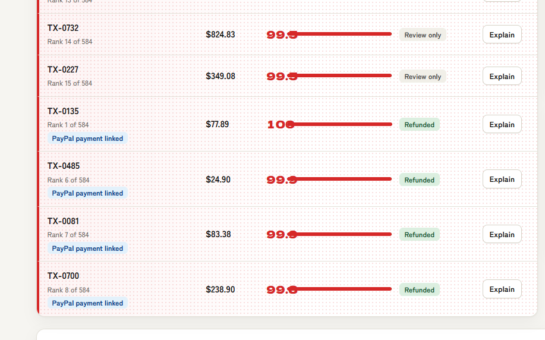

# GhostRing

**Fraud triage that a small seller can trust, explain and act on.**

GhostRing helps small PayPal sellers find fraudulent payments using as few as five confirmed fraud cases. It ranks incoming payments, shows the closest confirmed frauds as evidence for every flag, and sends a refund through PayPal only after both code and a person have approved it.

**[▶ Demo video](https://www.youtube.com/watch?v=xzbtp27wsbg)**  · **[Website preview](https://garlapatiraviteja.github.io/Graph-Ring/?demo)** · [Setup](SETUP.md) · MIT licensed

Built for the PayPal AI Hackathon.

## The problem

Fraud tools are built for companies with thousands of labelled cases. A small seller has a handful of confirmed frauds, and what most tools hand back is a bare risk score: a number the seller cannot act on, cannot explain to a customer, and cannot defend in a dispute.

## Our approach

GhostRing starts from the cases the seller already trusts. Each new payment is compared with the confirmed frauds and known-good payments the seller has, and every flag comes with the closest confirmed cases as proof. There is no training step.

On the public ULB credit-card benchmark, it reaches 0.81 to 0.83 PR-AUC from five to 25 confirmed frauds. That is within about two points of a Random Forest, which is slightly more accurate and much faster (see [Results](#results)). On the bundled demo sample, 10 of the top 10 flags were real fraud, scored against labels the system never saw. That sample is small, so the benchmark remains the main evidence of accuracy.

Responsibility is split deliberately. Gemini drafts the explanation and proposes an action. Plain code verifies the text and makes the decision. A person confirms. PayPal confirms that the payment is refundable. No single step can move money alone.

## PayPal at a glance

PayPal is the system of record at every point where money is involved.

- **PayPal holds the payments.** The demo payments are real PayPal sandbox orders, created and captured through the Orders API.
- **PayPal confirms before money moves.** The app reads the capture back and blocks the refund if PayPal reports any status other than `COMPLETED`, or a different amount.
- **PayPal issues the refund.** The app calls the refund endpoint under an idempotency key, so a repeated click can never refund the same payment twice.
- **You can see it in the app.** Each linked payment shows a *PayPal record* box, the refund ID, a "Refunded via PayPal" total and a PayPal flow card.
- **Proven end to end.** Four sandbox payments were created, captured and refunded through the app, and PayPal shows each as `REFUNDED` ($425.07 in total; see [Verified PayPal sandbox results](#verified-paypal-sandbox-results)).
- **Sandbox only.** Every call targets the PayPal sandbox and uses test money.

## Testing it (for judges)

Every route is free and needs no login.

1. **Demo video.** Watch the demo video linked at the top of this page. The four linked sandbox payments were refunded during development (see [Verified PayPal sandbox results](#verified-paypal-sandbox-results)), so the app shows them as *Refunded* and no refund button is left to click. To run a live refund yourself, seed fresh payments with [SETUP.md](SETUP.md).
2. **Presentation.** Read the presentation linked at the top of this page for an overview of the project.
3. **Website preview.** Open the [website preview](https://garlapatiraviteja.github.io/Graph-Ring/?demo) to see the interface in your browser. GitHub Pages serves only the front end, so there is no backend behind it and the page shows clearly labelled simulated data, with no PayPal calls. Run the server (routes 4 and 5) to see real scoring and PayPal refunds.
4. **Run it with no keys.** Run `pip install -r requirements.txt` and `cp .env.example .env`, set `LLM_MODE=mock`, then start the app with `python -m uvicorn app:app --reload`. You get the scoring, evidence, verifier and review queue on the bundled sample. Sending a refund needs PayPal sandbox credentials (route 5).
5. **Run it with live PayPal refunds.** Follow [SETUP.md](SETUP.md). Any test credentials a judge needs are supplied in the Devpost testing instructions and never appear in this repository.

## Try it

Start the app (see [Run it yourself](#run-it-yourself)) and open it in your browser. The review queue lists the fifteen highest-risk payments. Rows tagged *PayPal payment linked* are backed by real sandbox payments, and the four seeded during development have already been refunded and show as *Refunded*. The rest carry a recommendation only.

Open a linked row with **Explain** and you will see the evidence, the AI's explanation, the verifier's verdict, and a *PayPal record* showing the payment's status and amount. If the verified decision is a refund and a PayPal payment is attached, confirm it to send a sandbox refund. Rows with no attached payment show a *Review only* note under the recommended action: the policy would refund them, but there is nothing in PayPal to refund. A payment can be fully refunded once, and the page shows how many remain. All money is sandbox test money.

If no backend answers, or the page is opened as a local file or with `?demo` added to the address, it falls back to a clearly labelled demo mode with simulated data and no PayPal calls. When the backend is running, the page always uses it.

## PayPal integration

**The flow:** a customer pays, the payment is captured in PayPal, GhostRing scores and explains it, a person confirms, PayPal verifies the capture, and PayPal issues the refund.

This is the step where a flag becomes money back, so it is built to be strict. PayPal is checked before any money moves, every call targets the sandbox, and the client refuses to start against any other host.

| PayPal REST call | Used by | Purpose |
| --- | --- | --- |
| `POST /v1/oauth2/token` | app, seeding script | Authenticate |
| `GET /v2/payments/captures/{id}` | app | Verify status and amount before a refund; at startup, learn which payments PayPal already shows as refunded |
| `POST /v2/payments/captures/{id}/refund` | app | Issue the refund under a `PayPal-Request-Id` idempotency key |
| `POST /v2/checkout/orders` | seeding script | Create the demo payments |
| `GET /v2/checkout/orders/{id}` | seeding script | Confirm the buyer has approved an order |
| `POST /v2/checkout/orders/{id}/capture` | seeding script | Capture approved orders so they can be refunded |

### Verified PayPal sandbox results

Four demo payments were created, approved by a sandbox buyer, captured and then refunded through the app. For each one, PayPal's own record of the capture now reads `REFUNDED`, and the app holds a matching refund receipt. All amounts are USD test money.

| Transaction | Amount | PayPal capture ID | PayPal refund ID | Refund status |
| --- | --- | --- | --- | --- |
| TX-0135 | $77.89 | `13H31123AR991810T` | `8J376810CS489174J` | COMPLETED |
| TX-0485 | $24.90 | `6AA268242U8174507` | `6LM96918AD5509200` | COMPLETED |
| TX-0081 | $83.38 | `02C52963EP228835C` | `8BK82312SS343845M` | COMPLETED |
| TX-0700 | $238.90 | `3LV68253J93115320` | `0N516169PF7820533` | COMPLETED |



*The review queue after the four refunds: each linked payment shows as Refunded, and rows with no PayPal payment attached are Review only.*

Total refunded: $425.07. Each refund went through the app's refund route, after a person confirmed it. The app first read the capture back from PayPal (`COMPLETED`, matching amount) and then called the refund endpoint. A refunded payment cannot be refunded again, so these four are now spent.

We call the REST API directly instead of going through the Agent Toolkit or MCP server. That keeps the step that moves money deterministic and auditable. Demo payments are created and captured with `seed_sandbox.py`. PayPal requires a buyer to approve each order, so that step is manual.

## How it works

**Score.** Graph Ghost is semi-supervised label propagation (label spreading; Zhou et al., 2004) on a k-nearest-neighbour similarity graph of payments (k = 10, cosine distance). The seller's confirmed frauds and known-good payments seed the graph. Their labels spread along similarity edges, and each unlabelled payment inherits a score from its neighbourhood. Nothing is trained. The output is a risk index from 0 to 100 that ranks new payments against one another.

**Evidence.** Each flag lists the three most similar confirmed frauds, ranked by cosine similarity, with their amounts and similarity scores. The seller can see exactly what the ranking rests on.

**Explain.** Gemini receives only the facts the scorer produced and returns a short explanation with a proposed action: `refund`, `review` or `approve`. The merchant policy is explicit. Refund only when the risk index is at least 60 and the nearest confirmed fraud has a similarity of at least 0.70.

**Verify.** Model output is treated as untrusted input. The explanation is accepted only if every number and transaction ID in it appears in the scorer's facts, and otherwise a template replaces it. Code, not the model, then fixes the action, downgrading a proposed refund to `review` unless both thresholds hold. The check fails closed: with no similarity evidence, there is no refund.

**Refund.** After a person confirms, the app reads the capture back from PayPal and blocks the refund if PayPal reports any status other than `COMPLETED`, or a different amount. If that lookup itself fails, PayPal still validates the refund request. The app then issues the refund under an idempotency key, so a repeated click cannot refund twice.

## Results

Given 5, 10 or 25 confirmed frauds and 300 known-good payments, Graph Ghost reaches 0.81 to 0.83 PR-AUC on the public ULB credit-card dataset.

*Protocol.* The test set holds 30,492 transactions: all 492 frauds plus 30,000 legitimate ones. Each method sees only the stated labels and is scored on the transactions it was not given. PR-AUC is the area under the precision-recall curve, where 1.0 is perfect. Figures are the mean ± standard deviation over five seeds. Reproduce them with `python evaluate.py --csv data/creditcard.csv`; the raw output is in `results.json`.

| Known frauds | Graph Ghost | Logistic Regression | Random Forest |
| --- | --- | --- | --- |
| 5 | 0.811 ± 0.019 | 0.734 ± 0.206 | 0.832 ± 0.015 |
| 10 | 0.820 ± 0.023 | 0.744 ± 0.065 | 0.842 ± 0.012 |
| 25 | 0.827 ± 0.026 | 0.792 ± 0.030 | 0.853 ± 0.014 |

We want to be honest about what this shows. Graph Ghost trails Random Forest by roughly two points at every label budget, and it is the slower method, taking roughly 15 to 30 seconds against 0.5 to 2 on 30,000 rows. It is far more stable than logistic regression when labels are scarce, with a standard deviation of 0.019 against 0.206 at five labels. We claim comparable accuracy without training, not superiority. The real contribution is per-flag evidence and a verified path to a refund.

Two caveats apply. First, the sample is enriched: it is about 1.6% fraud, against roughly 0.17% in the source data, which flatters PR-AUC relative to production. Second, the method is transductive, scoring a batch with the unlabelled payments inside the graph, whereas the baselines are inductive and see only their labels.

On the sample bundled with the repository (4% fraud), 10 of the top 10 flags and 19 of the top 20 were fraudulent, measured against labels the system never saw. It is a single small sample, so treat the table above as the accuracy evidence.

## Safety design

The model proposes and code decides. Invented numbers or identifiers are rejected, and a template explanation covers any model failure. A refund needs three things: the code's approval, PayPal's confirmation that the payment is refundable, and a person's click. The risk index is a ranking signal, not proof of fraud, and the interface says so.

`python verifier.py` runs four tests:

- Text that uses only known numbers is accepted.
- Text with an invented amount and transaction ID is rejected.
- A refund is downgraded to `review` unless both thresholds hold.
- An invalid action is replaced.

## Limits

- **No ring detection.** The public data is anonymised, with no accounts, devices or emails, so the graph links transactions by feature similarity and GhostRing makes no fraud-ring claim.
- **Relative risk index.** The index is scaled so the top-ranked payment in a batch is always 100. It ranks payments against one another and is not an absolute probability, which is why the refund rule also demands a close confirmed-fraud match.
- **Narrow verification.** The verifier checks numbers and transaction IDs, not qualitative statements.

## Built during the hackathon

This section explains how the project was significantly updated during the Submission Period (1 October to 12 November 2026).

Before the hackathon, there was only a research prototype of kNN-graph label propagation, tested on small textbook datasets (Iris and Wine). Everything specific to this project was built for the event: fraud scoring and evidence at scale, the baseline comparison, the Gemini explainer and its merchant policy, the verifier and its tests, the PayPal sandbox integration, the web app and the deployment setup.

## Tools

- **Gemini API:** writes the explanation and proposes the action. The model is set by `GEMINI_MODEL`, and the project was built and tested with `gemini-3.5-flash-lite`.
- **PayPal REST API (sandbox):** payments, status checks and refunds.
- **Graph Ghost:** our own method, implemented with scikit-learn and SciPy.
- **Backend:** FastAPI.
- **Front end:** plain HTML and JavaScript.
- **Deployment:** a `render.yaml` is included for Render.
- **Fonts:** Dela Gothic One and Zen Kaku Gothic New, loaded from Google Fonts (SIL Open Font License).

## Run it yourself

```
pip install -r requirements.txt
cp .env.example .env
python -m uvicorn app:app --reload
```

With `LLM_MODE=mock`, the app runs without API keys and uses template explanations. Live refunds need PayPal sandbox credentials and seeded payments. The demo sample ships in `data/demo_tx.csv`. To rebuild it or reproduce the benchmark, download `creditcard.csv` (Kaggle: mlg-ulb/creditcardfraud) into `data/`. [SETUP.md](SETUP.md) has the full steps, settings and a troubleshooting table.

## Next

Today the seller supplies confirmed frauds by hand. The next step is to ingest them from PayPal's Disputes API and webhooks, so that each newly confirmed fraud sharpens the next round of flags. This is not yet built.


